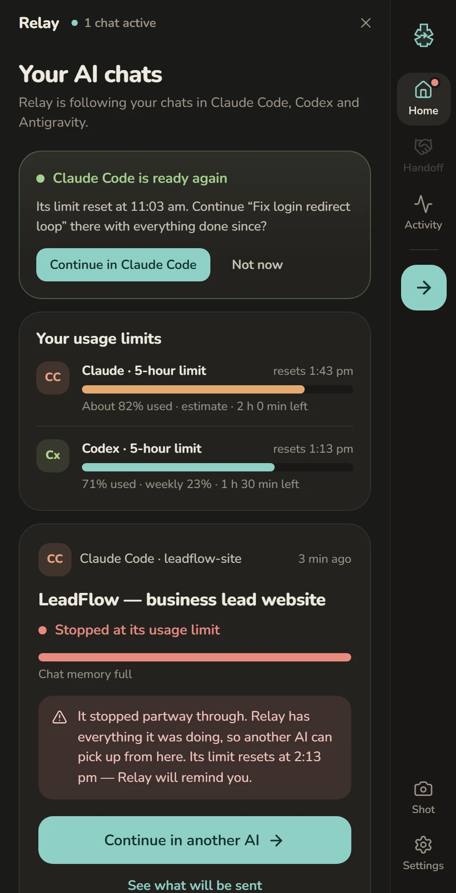
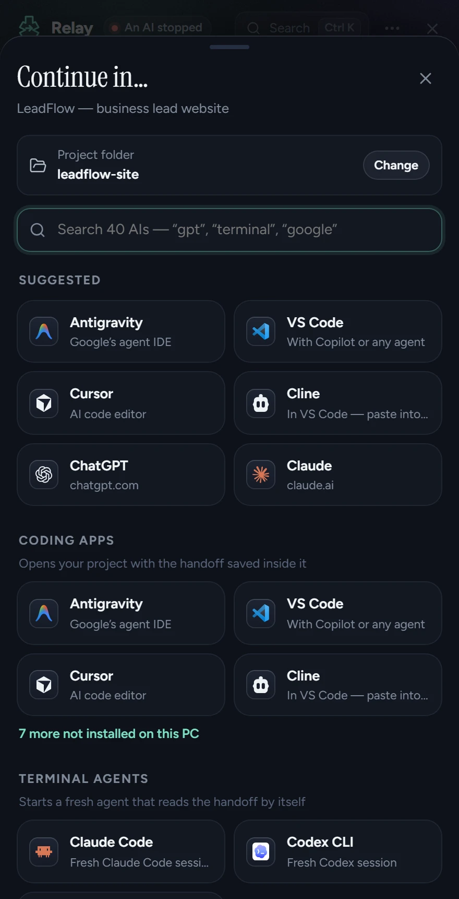
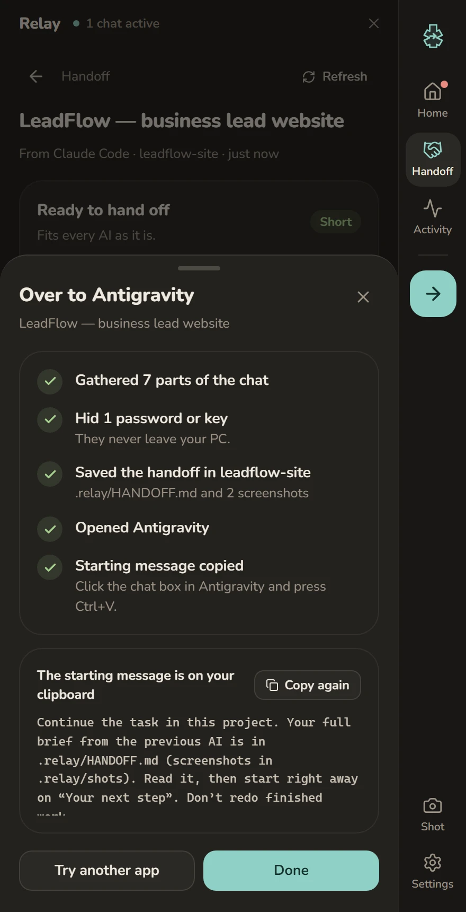

  

<h1 align="center">Relay</h1>

<b>When your AI stops halfway, the next one picks up.</b> 
A small panel on the side of your Windows screen that hands an AI's unfinished work to the next AI.

  <a href="https://github.com/agresh-agrawal/relay/releases/latest/download/Relay-Setup.exe"><b>Download for Windows</b></a> ·
  <a href="https://relayhandoff.agreshagrawal.com">Website</a> ·
  <a href="https://github.com/agresh-agrawal/relay/releases">All releases</a>

---

You're three hours into building something with Claude Code and it stops: *usage limit reached · resets 5pm*. Starting again in another AI means explaining the goal, your rules, what's finished, which files changed and what broke.

**Relay does that part for you.** A small Relay button sits on the edge of your screen and follows your Claude Code, Codex and Antigravity chats. When one stops, click it: Relay packs exactly what the next AI needs and opens your project in the AI you pick. Paste, and it carries on.

  
  
  

## Download

| | |
| --- | --- |
| **Installer** (recommended) | [Relay-Setup.exe](https://github.com/agresh-agrawal/relay/releases/latest/download/Relay-Setup.exe) · 5 MB · no admin rights needed |
| **Portable** | [Relay-Portable.exe](https://github.com/agresh-agrawal/relay/releases/latest/download/Relay-Portable.exe) · 10 MB · nothing to install |

Windows 10 and 11, 64-bit. Free.

### Install

1. Run **Relay-Setup.exe**. It installs just for you.
2. If Windows says **"Windows protected your PC"**, click **More info → Run anyway**. Relay isn't code-signed yet; this is normal for new apps.
3. Open **Relay** from the Start menu. A one-minute setup finds your AI chats. After that, the Relay button on the screen edge opens and closes it.

Some Windows 11 PCs have *Smart App Control* on, which blocks every unsigned app with no "Run anyway" button. Relay will never ask you to change security settings; a signed release is on the way.

## What it does

- **Watches your limits.** Shows when Claude's 5-hour window resets and roughly how much is used; Codex's exact percentages, weekly too; and how full each chat's memory is.
- **Keeps a handoff saved.** While an AI works, Relay keeps `.relay/HANDOFF.md` up to date in your project, even while Relay is closed.
- **Hands off in two seconds.** `Ctrl+Alt+R` or *Continue in another AI* → pick Antigravity, VS Code, Cursor, Windsurf, Claude Code, Codex CLI, Gemini CLI, ChatGPT, Claude, Gemini or AI Studio.
- **Writes a short brief, not a chat dump.** Goal, your rules word for word, what's done, what's left, where it stopped, open problems and changed files. About 640 tokens for a three-hour session.
- **Hides secrets.** API keys, tokens and passwords are removed before anything leaves your PC.
- **Works without an API key.** Add one (Anthropic, OpenAI, Gemini, OpenRouter, Ollama) for an even sharper brief. Keys are stored in Windows Credential Manager.
- **Reminds you at reset.** When a limit resets, Relay offers to bring the newest work back to that AI.
- **One click away.** A small button on the screen edge opens Relay over your work and closes it again. Drag it up or down; it hides for full-screen videos and games. Closed, Relay uses about 50 MB.

| Hotkey | |
| --- | --- |
| `Ctrl+Alt+Space` | Open / close Relay |
| `Ctrl+Alt+R` | Continue in another AI |
| `Ctrl+Alt+S` | Add a screenshot to the handoff |

## Privacy

Everything stays on your PC. Relay has no account and no tracking. It reads (never changes) the chat files your AI apps already save:

- `%USERPROFILE%\.claude\projects` (Claude Code)
- `%USERPROFILE%\.codex\sessions` (Codex)
- `%USERPROFILE%\.gemini\antigravity` (Antigravity)

It only talks to the internet if you add your own AI key, and then only to the provider you chose. Settings live in `%APPDATA%\com.relay.app`.

## Problems or ideas?

[Open an issue](https://github.com/agresh-agrawal/relay/issues). Please include your Windows version and what you were doing.

---

This repository holds the Relay downloads and the website ([`website/`](website), deployed to [relayhandoff.agreshagrawal.com](https://relayhandoff.agreshagrawal.com)). © 2026 Agresh Agrawal. Free to download and use.
